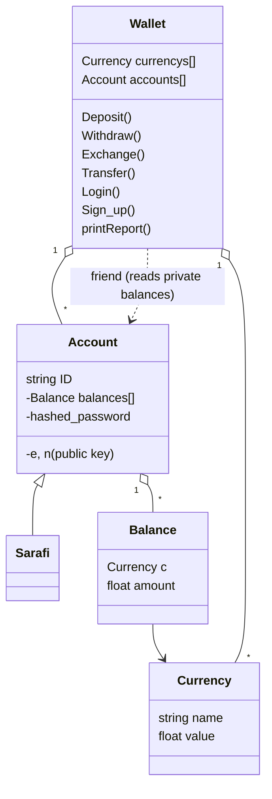

# Jib Pool – a virtual wallet, built in stages

A virtual-wallet system that grew over two phases of a university programming course: from a hand-written **hash function and RSA** in C, to an **object-oriented C++ console app** with sign-up, login, role-based permissions and file persistence.

```
C (procedural)                                    C++ (object-oriented)
hash + RSA  →  one account  →  many users  →  files   →   OOP wallet  →  console app
   01             02              03            04           oop_wallet     wallet_console_app
```

It is a learning project. The goal was to implement the pieces myself (hashing, RSA, fee rules, file storage, class design), **not** to build something secure. See [Limitations](#limitations).

## Contents

- [Quick start](#quick-start)
- [What the wallet does](#what-the-wallet-does)
- [Programs](#programs)
- [Example: the console app](#example-the-console-app)
- [Command reference](#command-reference)
- [Fees](#fees)
- [How it works](#how-it-works)
- [File formats](#file-formats)
- [Tests](#tests)
- [Limitations](#limitations)

## Quick start

Needs `make` and a C/C++ compiler (`gcc`/`g++` or Apple `clang`). On macOS, run `xcode-select --install` once.

```bash
git clone <this repo>
cd <this repo>
make test        # builds everything into build/ and runs 14 checks
```

Expected last line: `14 passed, 0 failed`.

Run a single program by feeding it a sample input:

```bash
./build/03_multi_user_transfers < samples/03_multi_user/s2.in
```

## What the wallet does

- Keeps balances in several virtual currencies. Each currency has a value relative to the base currency `jibCoin`.
- Supports **deposit**, **withdraw**, **exchange** (convert between currencies) and **transfer** (user to user).
- Charges a fee on exchanges and transfers. Fees, and the other side of every deposit, withdrawal and exchange, go through a special **exchange account** (`SARAFI`), which represents the service operator.
- Rejects bad requests with `Insufficient Funds: <user>`, `Invalid User: <user>` or `Invalid Command`.

## Programs

| Program | Lang | What it adds |
|---|---|---|
| [`01_hash_rsa.c`](phase1_c/01_hash_rsa.c) | C | A custom 16-character one-way hash, then RSA-encrypts each character of the hash |
| [`02_in_account.c`](phase1_c/02_in_account.c) | C | Deposit / withdraw / exchange inside one account, with fees and error handling |
| [`03_multi_user_transfers.c`](phase1_c/03_multi_user_transfers.c) | C | Many accounts + exchange account; every command arrives **RSA-encrypted** and is decrypted before it runs |
| [`04_file_persistence.c`](phase1_c/04_file_persistence.c) | C | Balances, user keys and a transaction report are stored in files (state survives a restart); adds `REPORT <user>` |
| [`oop_wallet.cpp`](phase2_cpp/oop_wallet.cpp) | C++ | Program 03 redesigned with classes: `Wallet`, `Account`, `Sarafi`, `Currency`, `Balance` |
| [`wallet_console_app.cpp`](phase2_cpp/wallet_console_app.cpp) | C++ | Interactive app: sign-up / login, per-role permissions, all data in files |

## Example: the console app

Start the app (after `make`) in a folder that contains the data files (see [File formats](#file-formats); `tests/run_tests.sh` builds a working set):

```text
$ ./build/wallet_console_app
Hi.Welcome to our Bank!
Login or Sign_up ?
Login
Username: alice
Password: pw
Enter operations:
To end the program enter Exit
TRANSFER alice bob jibCoin 20
```

Afterwards the files have changed immediately:

```text
jibCoin.txt           log.txt
SARAFI 1002           alice TRANSFER alice bob jibCoin 20 1
alice 78              bob TRANSFER alice bob jibCoin 20 1
bob 220
```

`alice` paid 20 + a 2 fee (10 % of a small transfer), `bob` received 20, and the fee went to `SARAFI`. The transfer is logged once for each side, and the trailing `1` means it succeeded.

Signing up creates a key pair and shows the private key exactly once:

```text
Login or Sign_up ?
Sign_up
Username: carol
Password: pw3
Enter account number:
300 40
Your Private key is: 4325
```

Only the public key and the hashed password are stored. (The terminal does not hide what you type, another thing a real app would do differently.)

## Command reference

| Command | Who may run it | Effect |
|---|---|---|
| `TRANSFER <from> <to> <currency> <amount>` | the `<from>` user | Moves money to another user; fee goes to `SARAFI` |
| `WITHDRAW <user> <currency> <amount>` | that user | Moves the amount to `SARAFI` (cash out) |
| `EXCHANGE <user> <cur1> <cur2> <amount>` | that user | Converts `<amount>` of `cur1` into `cur2` at the currencies' relative values |
| `REPORT <user>` | that user | Prints every logged transaction of the user |
| `DEPOSIT <user> <currency> <amount>` | the exchange account only | Credits a user (cash in) |

Phase 1 problem 2 has a single account, so its commands omit the user (`DEPOSIT <cur> <amount>`, `WITHDRAWL <cur> <amount>`, `EXCHANGE <cur1> <cur2> <amount>`). The `WITHDRAWL` spelling comes from the assignment text.

## Fees

| Operation | Amount | Fee (paid in the same currency to `SARAFI`) |
|---|---|---|
| Transfer | ≤ 100 | 10 % of the amount |
| Transfer | > 100 | flat, worth 10 `jibCoin` |
| Exchange | ≤ 1000 | 1 % of the amount |
| Exchange | > 1000 | flat, worth 10 `jibCoin` |

## How it works

**Hash function.** Each character `c` becomes `((3·ascii(c) + 17) mod 26) + 65`. The values of all characters at positions with the same remainder mod 16 are summed, and each sum becomes one letter (`sum mod 26 + 65`). The result is always 16 letters. It is intentionally simple and **not** collision-resistant.

**RSA.** Two primes `p`, `q` give `n = p·q` and `φ = (p−1)(q−1)`. `e` is the smallest number coprime to `φ`, and `d` comes from `d = (k·φ + 1) / e` for the smallest `k` that gives a whole number. Text is encrypted character by character as `ascii^e mod n`. Incoming commands use `p = 101`, `q = 19` (`n = 1919`). The console app generates a new key pair per user from consecutive primes.

**Class design (phase 2).**



- All commands are methods of `Wallet`, the only class allowed to read or change an account's private balances (declared `friend`).
- `Sarafi`, the exchange account, inherits from `Account`.
- In the console app the role decides what is allowed: customers act on their own account only; `DEPOSIT` is reserved for the exchange account.

## File formats

The console app keeps its state in plain text files in the current directory and reloads them on start-up. The first line of every currency file and of `users.txt` belongs to the exchange account.

| File | One line per … | Format |
|---|---|---|
| `currencies.txt` | currency | `<name> <value>` |
| `<Currency>.txt` (e.g. `jibCoin.txt`) | user | `<user_id> <balance>` (zero balances are kept) |
| `users.txt` | user | `<user_id> <hashed_password> <e> <n>` (public key only) |
| `log.txt` | transaction (a transfer is logged for both sides) | `<user_id> <command> <1 = success, 0 = failed>` |

Program 04 uses a simpler layout (`report.txt`, `USERS.txt`); see its source.

## Tests

```bash
make test
```

Runs 14 checks: the samples from the problem statements plus scripted multi-session runs for the file-based programs (including permission checks: a customer can't `DEPOSIT` or touch another user's account). The programs are also clean under AddressSanitizer / UBSan.

A few long sample lines were cut off in the problem statements. For those (`01_hash_rsa` s2/s3, `03_multi_user` s1) I checked the visible part by hand and stored the program's full output, so they act as regression tests rather than independent ground truth.

## Limitations

- **Not secure.** The hash and RSA use toy parameters and tiny primes; don't use them for anything real.
- **Console app:** handles one command per run (a loop until `Exit` is the obvious next step), and errors such as `Insufficient Funds` are logged as failures but not printed to the user.
- **Money is stored as `float`.** Integer cents or a decimal type would be correct.
- **Fixed-size arrays** (100 accounts/currencies) and variable-length arrays (a compiler extension in C++). `std::vector` would remove both.
- Crypto helpers in the console app are free functions; they belong inside the classes.
- Unknown currency or user names are mostly caught by validation, but some code paths still assume a lookup succeeds.

## Background

Written as coursework. The original problem statements are not included in this repository.
